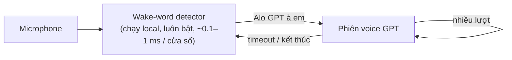

# Lightweight Wake Word Detection — “Alo GPT à em”

Một mô hình nhỏ chạy liên tục trên thiết bị và chỉ lắng nghe câu kích hoạt tiếng
Việt **“Alo GPT à em”**. Khi phát hiện, hệ thống mở phiên hội thoại giọng nói với GPT. Trong phiên, người dùng có
thể nói nhiều lượt mà không cần lặp lại wake word. Phiên tự đóng khi im lặng quá thời gian timeout.



**Vì sao không chạy STT liên tục?** STT trả lời câu hỏi *“người dùng đang nói gì?”*, còn wake-word detector trả
lời câu hỏi *“đây có phải lúc cần đánh thức trợ lý không?”*. Tách riêng detector có bốn lợi ích:
- Chi phí tính toán thấp hơn nhiều bậc, nên chạy được 24/7.
- Không có audio nào rời khỏi thiết bị cho tới khi nghe thấy wake word.
- Có thể tối ưu trực tiếp theo FRR và số lần kích hoạt nhầm mỗi giờ, thay vì theo WER.
- Hệ thống dạng module, dễ thay thế từng phần.

Script `scripts/stt_baseline.py` đo kiểm chứng nhận định này trên chính dữ liệu của nhóm.

## Các hướng tiếp cận được so sánh

| | Hướng tiếp cận | Mục đích kiểm chứng |
|---|---|---|
| **A** | DS-CNN trên log-mel, train từ đầu | CNN KWS nhỏ kinh điển (Hello Edge) |
| **B** | TC-ResNet8 (tích chập 1-D theo thời gian) | cân bằng tốt giữa độ chính xác và latency cho KWS |
| **C** | Embedding giọng nói openWakeWord (đóng băng) + head nhỏ | transfer learning từ mô hình giọng nói pretrained |
| **D** | Whisper / PhoWhisper + so khớp chuỗi | baseline “dùng luôn STT” |
| +  | CRNN | baseline dạng hồi quy (recurrent) |
| **Ablation dữ liệu** | chỉ người thật → + TTS → + augmentation → + hard negatives (V1) → + mined hard negatives (V2) | ảnh hưởng của thiết kế dataset lên FRR / FA/giờ |
| **Nén mô hình** | ONNX FP32 → lượng tử hóa tĩnh INT8 | đánh đổi giữa kích thước, latency và độ chính xác |

## Cấu trúc repo

```
wakeword/            thư viện: đọc/ghi audio, đặc trưng, augmentation, dataset + chia theo người nói, mô hình,
                     chấm điểm, streaming detector, metric, máy trạng thái phiên hội thoại, theo dõi MLflow
scripts/             CLI: công cụ dữ liệu, train, evaluate, mining, export, baseline STT, chạy toàn bộ thí nghiệm
apps/demo_app.py     demo Gradio (phân tích file + mic trực tiếp + thông tin model)
apps/collect_app.py  app Gradio thu âm dữ liệu (chia sẻ link được cho người ngoài nhóm)
configs/             cấu hình YAML (base + mỗi hướng tiếp cận + ablation dữ liệu + smoke test)
docker/              Dockerfile CPU (target demo/train) và GPU; docker-compose.yml nằm ở thư mục gốc
tests/               unit test + smoke test end-to-end trên dữ liệu tổng hợp
docs/PLAN.md         kế hoạch, giao thức thu dữ liệu, phân công, dàn ý report/slides
```

## Bắt đầu nhanh

```bash
python -m venv .venv && source .venv/bin/activate        # Windows: .venv\Scripts\activate
pip install torch torchaudio --index-url https://download.pytorch.org/whl/cpu   # hoặc bản CUDA
pip install -r requirements-dev.txt

# 1) kiểm tra toàn bộ pipeline trên audio tổng hợp (~1 phút)
pytest -q

# 2) chạy thử demo với một model đồ chơi train trên dữ liệu tổng hợp
python scripts/make_synthetic_data.py --out data_synth
python scripts/build_manifest.py -c configs/smoke.yaml
python scripts/train.py -c configs/smoke.yaml --set train.epochs=15 train.steps_per_epoch=40
python apps/demo_app.py --runs runs_smoke                 # http://localhost:7860
```

## Dữ liệu

### Chính sách gán nhãn
Một sample là **positive khi và chỉ khi sản phẩm nên thức dậy** trong tình huống đó.

| thư mục category | nhãn | ví dụ |
|---|---|---|
| `positive`, `positive_command`, `positive_pause` | 1 | “Alo GPT à em”, “Alo GPT à em, xem lịch ngày mai”, ngập ngừng ≤ 0,5 s |
| `hard_partial`, `hard_substitution`, `hard_phonetic`, `hard_reorder`, `hard_common`, `hard_long_pause`, `hard_mined` | 0 | “Alo GPT”, “Alo GPT à anh”, “Alo GPS à em”, “GPT à em alo”, “Alo em à, anh đây”, dừng ≥ 1,5 s |
| `neg_speech`, `neg_length_matched`, `neg_noise`, `neg_silence` | 0 | câu nói ngẫu nhiên, câu có độ dài tương đương, tiếng quạt/TV/đường phố |
| `challenge_narrative`, `challenge_mid_pause` | −1 | “Hôm qua tôi cứ nói Alo GPT à em mà…”, dừng 0,5–1,5 s. Không dùng để train, báo cáo riêng |

Danh sách câu nhắc (prompt) nằm trong `wakeword/phrases.py`.

### Cấu trúc thư mục
```
data/raw/real/<speaker>/<category>/*.wav       người thật (người ngoài nhóm đặt tiền tố ext_ → chỉ dùng test)
data/raw/tts/<voice>/<category>/*.wav          giọng tổng hợp (mặc định vào train)
data/raw/speech/<corpus>/<speaker>/**/*.wav    tiếng Việt từ bộ dữ liệu công khai → neg_speech
data/raw/noise/**/*.wav                        âm thanh không phải lời nói → neg_noise + noise cho augmentation
data/raw/long/<train|val|test>/*.wav           nhiều giờ audio negative liên tục (đo FA/giờ, mining)
data/rir/*.wav                                 room impulse response (augmentation tiếng vang)
data/mined/<tag>/*.wav                         hard negative khai thác được (chỉ dùng train)
```

### Thu âm và sinh dữ liệu
```bash
python apps/collect_app.py --share                       # thu âm có hướng dẫn; gửi link cho bạn bè
python scripts/generate_tts.py --backend edge mms --variants 6   # pip install -r requirements-tts.txt
python scripts/compose_pauses.py                         # "Alo GPT" + khoảng dừng + "à em" → dữ liệu cho policy về pause
python scripts/download_data.py esc50 rirs               # noise + RIR  (có thêm musan, hf --repo ...)
python scripts/make_long_negatives.py --hours 2 --split test   # nếu chưa có bản ghi dài thật
python scripts/build_manifest.py -c configs/base.yaml    # chia theo người nói + kiểm tra leakage
```
**Quy tắc chia dữ liệu:** người nói ở train, val và test không bao giờ trùng nhau (gán bằng hash cố định, hoặc chỉ
định qua `split.test_speakers`). Tập test quan trọng nhất gồm **người thật chưa từng xuất hiện khi train**, cả điều
kiện sạch và có nhiễu, cùng với **audio negative liên tục dài**.

## Train, đánh giá, mining, nén mô hình

```bash
python scripts/train.py    -c configs/tc_resnet.yaml [--set train.epochs=40 tracking.enabled=true]
python scripts/evaluate.py --checkpoint runs/tc_resnet/best.pt
python scripts/export_onnx.py --checkpoint runs/tc_resnet/best.pt          # ONNX FP32 + INT8
python scripts/evaluate.py --checkpoint runs/tc_resnet/best.pt --onnx runs/tc_resnet/best.int8.onnx --tag int8
python scripts/mine_hard_negatives.py --checkpoint runs/abl_a3_plus_hardneg/best.pt --tag v1
python scripts/stt_baseline.py --model vinai/PhoWhisper-tiny --max-long-hours 0.5   # requirements-stt.txt
python scripts/run_experiments.py              # chạy toàn bộ ma trận thí nghiệm → runs/comparison.md
```

Báo cáo đánh giá (`runs/<exp>/eval_<split>_<backend>/`) gồm:
- **Mức clip:** AUC, EER, FRR/FAR tại ngưỡng hiệu chỉnh trên tập validation, tỷ lệ kích hoạt theo từng category, FRR
  theo từng người nói.
- **Streaming:** cửa sổ trượt 2 s với bước nhảy 100 ms, làm mượt điểm số theo kiểu nhân quả và thời gian refractory
  2 s. Báo cáo FRR trên positive, **số lần kích hoạt nhầm mỗi giờ** trên audio dài, **đường DET** (`det.png`) và FRR
  tại các ngân sách FA/giờ (0,1 / 0,5 / 1).
- **Hiệu năng:** số tham số, MACs mỗi cửa sổ và latency trên CPU (trích đặc trưng + model, 1 luồng).

## Demo, Docker, MLOps

```bash
docker compose up demo mlflow           # demo → http://localhost:7860, MLflow → http://localhost:5000
docker compose up collect               # app thu âm → http://localhost:7861
docker compose run --rm train           # train trên CPU, ghi log vào MLflow
docker compose --profile gpu run --rm train-gpu
```
- **Các tab của demo:** (1) upload hoặc thu một đoạn audio, xem điểm wake theo thời gian, các lần kích hoạt và phiên
  hội thoại mô phỏng; (2) mic trực tiếp dạng streaming với máy trạng thái IDLE ⇄ SESSION; (3) kích thước và latency
  của model. Phiên GPT mặc định dùng backend mock. Đặt `WAKEWORD_BACKEND=openai` và `OPENAI_API_KEY` để chuyển lời nói
  thành văn bản và trả lời bằng chat model.
- **MLflow:** đặt `tracking.enabled=true` để ghi lại config, metric theo từng epoch và các artifact.
- **DVC (không bắt buộc):** `dvc.yaml` định nghĩa các bước manifest → train → eval, kèm biểu đồ DET.
- **CI:** `.github/workflows/ci.yml` chạy ruff và pytest (gồm cả pipeline end-to-end trên dữ liệu tổng hợp), sau đó
  build image demo.

## Kết quả

Điền từ `runs/comparison.md` sau khi có dữ liệu thật.

| Model | Tham số | MACs | Kích thước INT8 | FRR @ 0,5 FA/giờ | FA/giờ @ ngưỡng val | Tỷ lệ kích hoạt hard-neg | Latency |
|---|---|---|---|---|---|---|---|
| DS-CNN | | | | | | | |
| TC-ResNet8 | | | | | | | |
| OWW embedding + head | | | | | | | |
| PhoWhisper-tiny + so khớp | | – | – | | | | |

## Tài liệu tham khảo
- Y. Zhang và cộng sự, *Hello Edge: Keyword Spotting on Microcontrollers*, 2017 (DS-CNN).
- S. Choi và cộng sự, *Temporal Convolution for Real-time Keyword Spotting on Mobile Devices*, Interspeech 2019 (TC-ResNet).
- D. Scripka, *openWakeWord* (Apache-2.0); mô hình speech-embedding của Google.
- D. Park và cộng sự, *SpecAugment*, 2019. T. Ko và cộng sự, *A study on data augmentation of reverberant speech*, 2017 (RIR).
- Bộ dữ liệu: ESC-50, MUSAN, OpenSLR-28 RIRS_NOISES, VIVOS / FLEURS (tiếng Việt). Cần kiểm tra license trước khi dùng.
- VinAI PhoWhisper; OpenAI Whisper.
